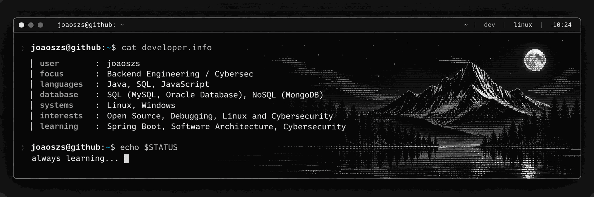

<div align="center">



<br />

<a href="https://github.com/joaoszs">
  
</a>
<a href="https://www.linkedin.com/in/jo%C3%A3ol%C3%BAcio/">
  
</a>

<br /><br />

<samp>Backend Development • Systems Integration • Continuous Learning</samp>

</div>

---

### `> whoami`

Olá! Sou **João Lúcio**, profissional de tecnologia com atuação em **análise técnica, sustentação de sistemas e desenvolvimento backend**.

Gosto de entender o problema de ponta a ponta, do código e dos logs até o banco de dados, para identificar sua causa raiz.

Meu objetivo é evoluir como engenheiro de software, construindo aplicações confiáveis, escaláveis e bem estruturadas.

Além da rotina profissional, gosto de explorar o ecossistema Linux, aprender novas ferramentas de desenvolvimento e entender o funcionamento dos sistemas além da camada de código. Para mim, tecnologia é tanto profissão quanto curiosidade.

### `> tech --visual`

<div align="center">


<sub>Tecnologias e ferramentas que utilizo ou estou estudando.</sub>

</div>

### `> stack --current`

**No dia a dia:**

`Java` · `JSP` · `JavaScript` · `Oracle Database` · `SQL` · `PL/SQL` · `Linux` · `Git` · `SOAP / XML` · `Eclipse` · `Spring Boot` · `REST APIs/SOAP` 

**Em evolução:**

`Automated Testing` · `Backend Architecture` · `Clean Code` · `SOLID`

### `> what-i-do`

- **Investigação e análise técnica:** depuração de aplicações, análise de código-fonte, rastreamento de fluxos de execução, interpretação de logs e identificação de causas raiz para diagnóstico e resolução de problemas.
- **Banco de dados:** elaboração e otimização de consultas SQL, análise de dados e PL/SQL com Oracle Database, incluindo procedures, functions, triggers e packages.
- **Integração de sistemas:** análise, manutenção e diagnóstico de integrações entre aplicações, utilizando serviços SOAP, APIs REST, mensagens XML e protocolos de comunicação.
- **Desenvolvimento e engenharia de software:** manutenção e evolução de aplicações Java, implementação de correções e melhorias, aplicação de boas práticas de programação, desenvolvimento de projetos práticos e contribuições para projetos open source.

### `> featured-project`

**[Backend Engineering Journey — Java & Spring Boot](https://github.com/joaoszs/backend-engineering-journey-java-springboot)**

Repositório que utilizo para aprofundar meus conhecimentos em desenvolvimento backend, praticar Java, revisar código e contribuir com um projeto open source.

### `> currently-learning`

```text
[01] Java & Object-Oriented Programming
[02] Spring Boot & REST APIs
[03] Oracle SQL / PL/SQL
[04] Linux & Infrastructure
[05] Software Architecture & Automated Testing
```

---

<div align="center">

<samp>learn • build • debug • improve</samp>

<a href="https://github.com/joaoszs">github.com/joaoszs</a>

</div>
