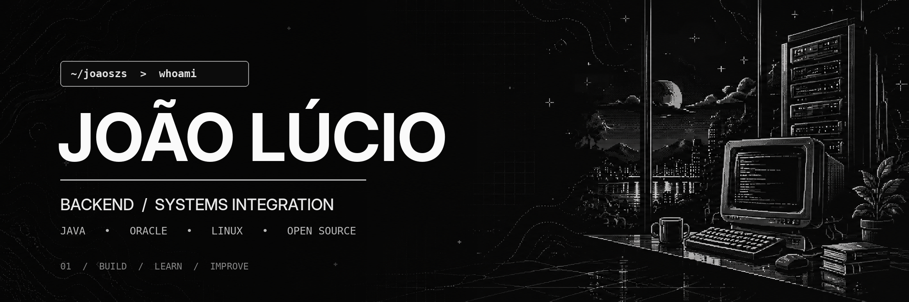

<div align="center">



<br />

<a href="https://github.com/joaoszs"></a>
<a href="https://www.linkedin.com/in/jo%C3%A3o-l%C3%BAcio-reis-da-costa-3a087b2b1/"></a>

<br /><br />

<samp>Backend development &nbsp;•&nbsp; Systems integration &nbsp;•&nbsp; Continuous learning</samp>

</div>

---

### `> whoami`

Olá! Sou **João Lúcio**, profissional de tecnologia com atuação em **análise técnica e sustentação de sistemas corporativos na área da saúde**.

No meu dia a dia, investigo comportamentos de aplicações **Java**, analiso consultas e rotinas em **Oracle Database / SQL / PL/SQL** e acompanho integrações entre sistemas. Gosto de entender o problema de ponta a ponta — do código e dos logs até o banco de dados — para chegar à sua causa raiz.

Estou aprofundando meus conhecimentos em **desenvolvimento backend com Java e Spring Boot** e participando de iniciativas **open source**. Meu objetivo é construir soluções confiáveis, bem estruturadas e fáceis de evoluir.

### `> tech --visual`

<div align="center">


<sub>Uma parte das tecnologias e ferramentas que uso ou estudo, em movimento.</sub>

</div>

### `> stack --current`

**No dia a dia:** `Java` · `JSP` · `JavaScript` · `Oracle Database` · `SQL` · `PL/SQL` · `Linux` · `Git` · `SOAP / XML` · `Eclipse`

**Em evolução:** `Spring Boot` · `APIs REST` · `Testes automatizados` · `Arquitetura backend` · `Boas práticas de código`

### `> what-i-do`

- **Investigação técnica:** rastreamento de fluxos, leitura de logs, depuração e análise de causa raiz.
- **Banco de dados:** consultas SQL e estudo de recursos PL/SQL no Oracle.
- **Integração de sistemas:** análise de serviços, mensagens XML e comunicação entre aplicações.
- **Engenharia de software:** estudos, projetos práticos e colaboração com a comunidade open source.

### `> featured-project`

**[backend-engineering-journey-java-springboot](https://github.com/joaoszs/backend-engineering-journey-java-springboot)**  
Repositório em que venho praticando Java, revisão de código e contribuição open source.

### `> currently-learning`

```text
[01] Java + Programação Orientada a Objetos
[02] Spring Boot + APIs REST
[03] Oracle SQL / PL/SQL
[04] Linux + fundamentos de infraestrutura
[05] Testes + arquitetura + qualidade de software
```

---

<div align="center">
  <samp>learn • build • debug • improve</samp>
  <br /><br />
  <a href="https://github.com/joaoszs">github.com/joaoszs</a>
</div>
